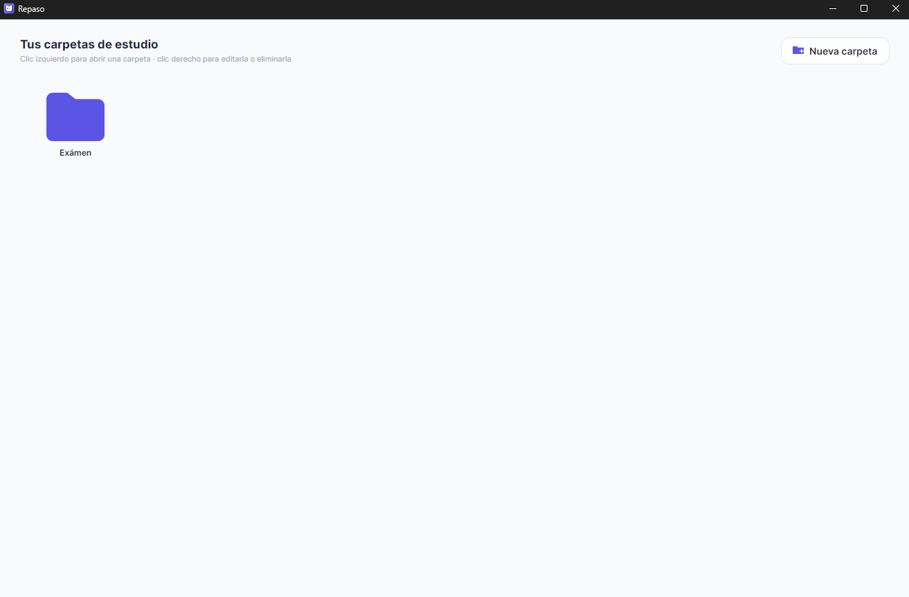
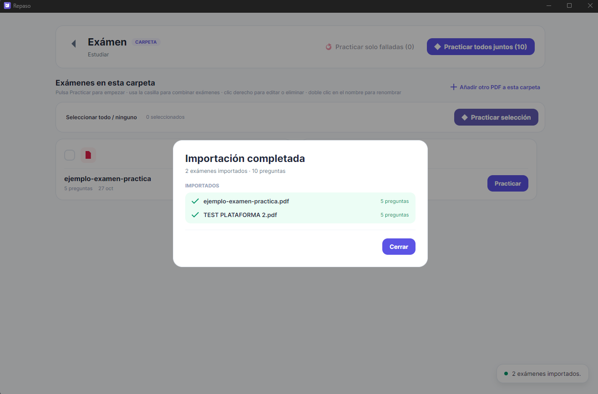
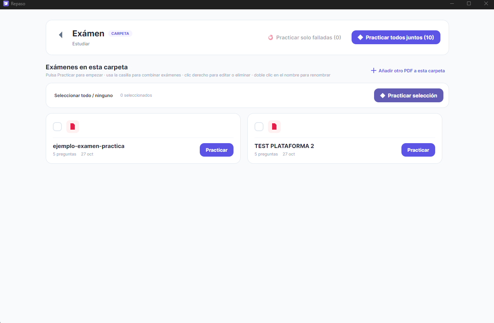
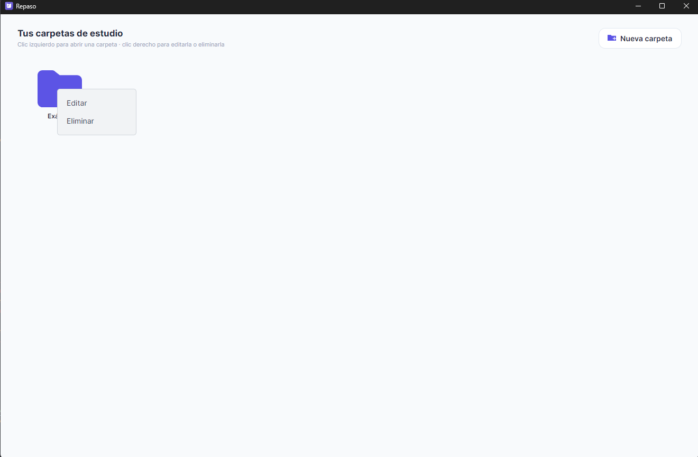
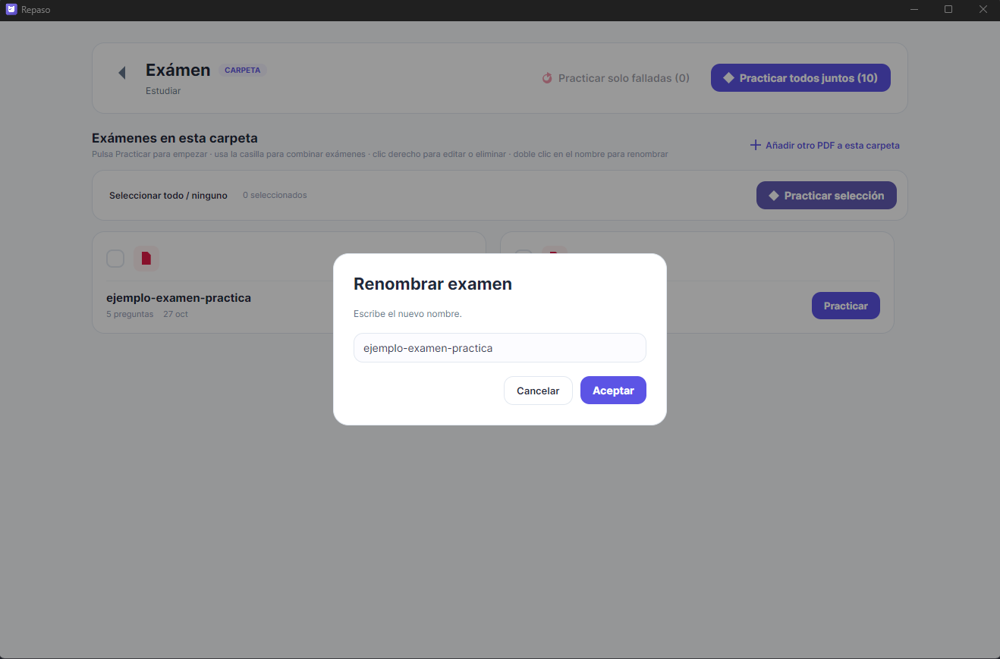
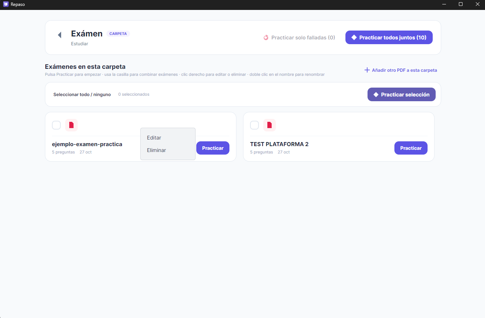
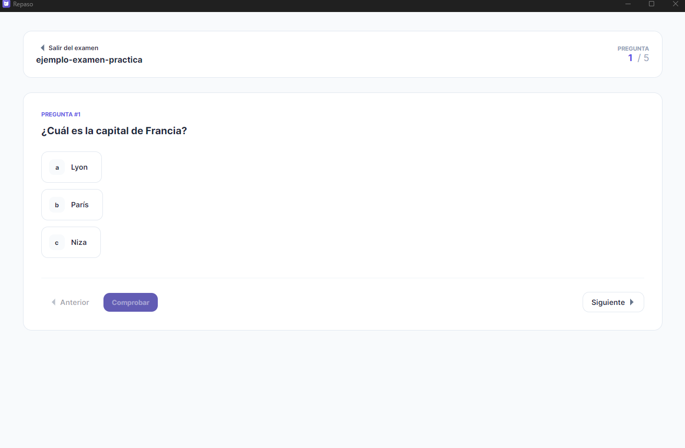
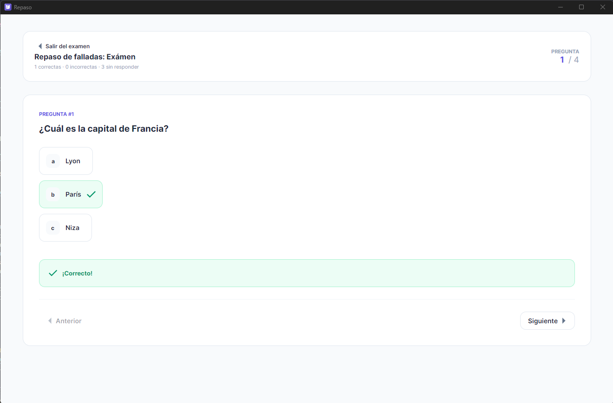

# Repaso

Aplicación de escritorio para organizar exámenes PDF y practicar sus preguntas tipo test.

Repaso convierte los documentos localmente, permite revisar y corregir las preguntas extraídas y
guarda la biblioteca y el progreso en el propio equipo. No usa servicios externos ni funciones de IA.

## Capturas

### Biblioteca






### Carpetas

| Abrir una carpeta con clic izquierdo | Editar una carpeta con clic derecho |
| --- | --- |
|  |  |

### Práctica

| Editar nombre test con doble clic en el nombre | Editar un test con clic derecho |
| --- | --- |
|  |  |

| Preguntas del examen | Repaso de preguntas falladas |
| --- | --- |
|  |  |

## Funciones

- Importar uno o varios PDF y organizarlos en carpetas con colores.
- Detectar preguntas y opciones a partir del texto y la disposición geométrica del PDF.
- Procesar documentos escaneados con el OCR nativo de Windows cuando está disponible.
- Practicar un examen, combinar varios exámenes o repasar preguntas falladas.
- Editar el enunciado, las opciones y la respuesta correcta después de importar.
- Guardar el progreso localmente, sin enviar los documentos a un servidor.

La extracción es automática y puede requerir correcciones, especialmente en documentos escaneados o
PDF con diseños poco habituales. Comprueba las preguntas y respuestas antes de utilizarlas para estudiar.

## Probar la aplicación

### Requisitos

- Windows 10 (versión 2004 o posterior) o Windows 11.
- [.NET 10 SDK](https://dotnet.microsoft.com/download/dotnet/10.0) para compilar desde el código.
- Para OCR: paquete de idioma español instalado en Windows.

### Ejecutar desde el código

```powershell
git clone https://github.com/MarioAJ11/Rpaso.git
cd Rpaso
dotnet restore
dotnet run
```

En la aplicación, crea o abre una carpeta y pulsa **Añadir otro PDF a esta carpeta**. Después,
selecciona uno de los documentos de ejemplo:

- [Ejemplo original de práctica](<Assets/ejemplo-examen-practica.pdf>): preguntas de demostración
  creadas para este proyecto.
- [TEST PLATAFORMA 2](<Assets/TEST PLATAFORMA 2.pdf>): PDF de ejemplo autorizado por su propietario.

Para compilar una versión Release:

```powershell
dotnet build -c Release
```

Para publicar una versión autocontenida de 64 bits:

```powershell
dotnet publish -c Release -r win-x64 --self-contained true
```

La publicación para distribución pública debe firmarse con un certificado de firma de código válido.
No distribuyas certificados de desarrollo ni instales certificados autofirmados en equipos de terceros.

## Privacidad y almacenamiento

Los PDF se procesan en el equipo. La aplicación no los sube a la nube ni necesita claves o conexión a
servicios de IA. La biblioteca y el progreso se guardan localmente en `%APPDATA%\Rpaso`.

## Arquitectura

- **Interfaz:** Avalonia UI y XAML.
- **Aplicación:** C# con MVVM (`CommunityToolkit.Mvvm`).
- **PDF:** PdfPig para extraer texto y posiciones.
- **OCR:** `Windows.Data.Pdf` y `Windows.Media.Ocr`.
- **Persistencia:** archivos JSON locales.

```text
Models/       Entidades y modelos de dominio
Services/     PDF, OCR, importación y almacenamiento
ViewModels/   Estado y lógica de presentación
Views/        Ventanas y vistas Avalonia
Assets/       Estilos, icono, ejemplos PDF y capturas
```

El proyecto apunta a Windows (`net10.0-windows10.0.19041.0`) debido a la integración con el OCR nativo.

## Limitaciones conocidas

- El parser está orientado principalmente a documentos de una columna.
- La calidad del OCR depende del escaneo y del paquete de idioma instalado.
- Si un PDF no contiene una clave reconocible, la respuesta deberá revisarse en el editor.

## Licencia

Consulta [LICENSE.txt](LICENSE.txt) para las condiciones de uso y distribución del proyecto. Los
documentos PDF de ejemplo tienen sus propios derechos y no alteran la licencia del código.
